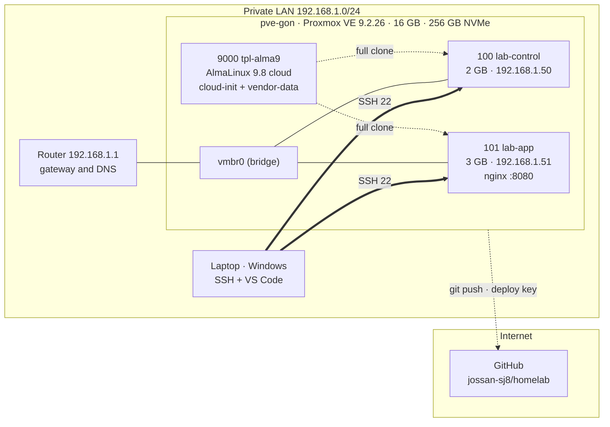

# homelab

[Versión en español](README.md)

Personal infrastructure lab for practicing Linux systems operations,
virtualization and automation. Everything runs on a private network, with no
internet exposure and no real data.

## Status

v0.1 — working lab: host, template, two VMs and a persistent service.

## Hardware

| Component | Value |
|---|---|
| Host | HP, Intel 9th-gen i5 |
| RAM | 16 GB |
| Disk | 256 GB NVMe (68 GB root + LVM thin pool) |
| Hypervisor | Proxmox VE 9.2.26 |
| Network | Private LAN, `192.168.1.0/24` |

## Architecture



| VMID | Name | RAM | IP | Role |
|---|---|---|---|---|
| 9000 | `tpl-alma9` | 2 GB | — | AlmaLinux 9.8 template |
| 100 | `lab-control` | 2 GB | `192.168.1.50` | Control: Ansible, kubectl |
| 101 | `lab-app` | 3 GB | `192.168.1.51` | Containerized services |

VMs are created from the template and configure themselves with cloud-init:
user, SSH key, hostname, static IP, firewall and guest agent.

## v0.1 scope

- [x] Proxmox host with correct repositories and fully updated.
- [x] Reusable AlmaLinux 9 template with cloud-init and vendor-data.
- [x] `lab-control` with static IP and key-based access.
- [x] `lab-app` with a containerized service, verified from `lab-control`.
- [x] One induced failure, diagnosed and documented.

## How to run

```bash
qm clone 9000 101 --name lab-app --full
qm set 101 --memory 3072 --ipconfig0 ip=192.168.1.51/24,gw=192.168.1.1 --nameserver 192.168.1.1
qm start 101
```

The service on `lab-app` is declared as a Quadlet unit at
`~/.config/containers/systemd/web.container`, with `Restart=on-failure` and
`loginctl enable-linger`.

## Security

- The lab is **not** exposed to the internet: no port forwarding.
- No credentials, keys or public IPs in this repository.
- Administrative access over SSH keys, not passwords.
- `firewalld` enabled on every VM; only the service port is opened.
- Passwordless `sudo` for the cloud-init user: lab convenience, not a production
  setting.

## Documents

- [PROGRESO_LAB.md](PROGRESO_LAB.md) — current state and next step.
- [DECISIONES.md](DECISIONES.md) — what was chosen and why.
- [ERRORES.md](ERRORES.md) — failures, root cause, prevention.
- [baseline.txt](baseline.txt) — host state at the v0.1 close.
- [cloud-init/alma9-vendor.yaml](cloud-init/alma9-vendor.yaml) — template declaration.
- [RUNBOOK.md](RUNBOOK.md) — what to do when something breaks.
