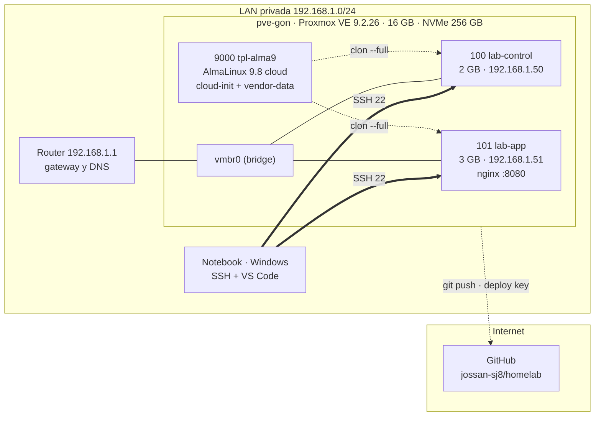

# homelab

[English version](README.en.md)

Laboratorio de infraestructura personal para practicar operación de sistemas
Linux, virtualización y automatización. Todo corre en una red privada, sin
exposición a internet y sin datos reales.

## Estado

v0.1 — laboratorio operativo: host, plantilla, dos VMs y un servicio persistente.

## Hardware

| Componente | Valor |
|---|---|
| Host | HP, Intel i5 9ª gen |
| RAM | 16 GB |
| Disco | NVMe 256 GB (68 GB raíz + thin pool LVM) |
| Hipervisor | Proxmox VE 9.2.26 |
| Red | LAN privada, `192.168.1.0/24` |

## Arquitectura



| VMID | Nombre | RAM | IP | Rol |
|---|---|---|---|---|
| 9000 | `tpl-alma9` | 2 GB | — | Plantilla AlmaLinux 9.8 |
| 100 | `lab-control` | 2 GB | `192.168.1.50` | Control: Ansible, kubectl |
| 101 | `lab-app` | 3 GB | `192.168.1.51` | Servicios contenerizados |

Las VMs nacen de la plantilla y se configuran solas con cloud-init: usuario,
llave SSH, hostname, IP fija, firewall y agente invitado.

## Alcance de v0.1

- [x] Host Proxmox con repositorios correctos y actualizado.
- [x] Plantilla AlmaLinux 9 reutilizable con cloud-init y vendor-data.
- [x] `lab-control` con IP fija y acceso por llave.
- [x] `lab-app` con un servicio contenerizado, verificado desde `lab-control`.
- [x] Fallo provocado, diagnosticado y documentado.

## Cómo se levanta

```bash
qm clone 9000 101 --name lab-app --full
qm set 101 --memory 3072 --ipconfig0 ip=192.168.1.51/24,gw=192.168.1.1 --nameserver 192.168.1.1
qm start 101
```

El servicio de `lab-app` se declara como unidad Quadlet en
`~/.config/containers/systemd/web.container`, con `Restart=on-failure` y
`loginctl enable-linger`.

## Seguridad

- El laboratorio **no** está expuesto a internet: sin reenvío de puertos.
- Sin credenciales, llaves ni IPs públicas en este repositorio.
- Acceso administrativo por SSH con llave, no por contraseña.
- `firewalld` activo en todas las VMs; sólo se abre el puerto del servicio.
- `sudo` sin contraseña para el usuario de cloud-init: comodidad de laboratorio,
  no configuración de producción.

## Documentos

- [PROGRESO_LAB.md](PROGRESO_LAB.md) — estado actual y próximo paso.
- [DECISIONES.md](DECISIONES.md) — qué se eligió y por qué.
- [ERRORES.md](ERRORES.md) — fallos, causa raíz, cómo evitarlos.
- [baseline.txt](baseline.txt) — estado del host al cerrar v0.1.
- [cloud-init/alma9-vendor.yaml](cloud-init/alma9-vendor.yaml) — declaración de la plantilla.
- [RUNBOOK.md](RUNBOOK.md) — qué hacer cuando algo falla.
